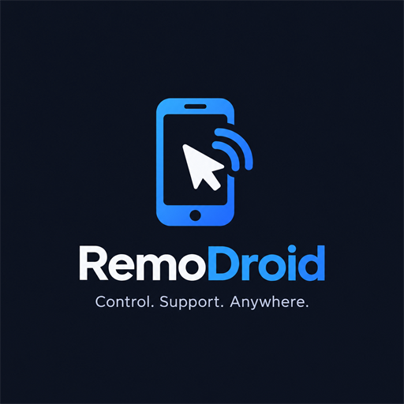

<p align="center"></p>

# RemoDroid

**Control. Support. Anywhere.**

RemoDroid is a remote-support app in the spirit of UltraViewer: one device shows a temporary ID and
password, a person you trust enters them, **you approve the request**, and they see your screen and,
if you allow it, help by tapping and typing. Roles can be reversed in the next session.

* **Android** app (Kotlin, Jetpack Compose) and **Windows** app (Kotlin, Compose Desktop), same protocol.
* **Node.js signaling server** (`server/`) with temporary credentials, approval flow and WebRTC relay.
* **WebRTC** for screen video and control data, direct when possible, via **TURN** when not, over Wi-Fi
  or mobile data, across NATs and different networks.

## Current capabilities

| | Android | Windows |
|---|---|---|
| Allow remote access (host) | ✅ MediaProjection capture, system consent each session, foreground notification | ✅ libwebrtc desktop capture (all monitors) |
| Control remote device (controller) | ✅ touch gestures → partner | ✅ mouse/keyboard → partner |
| Remote input on this device | ✅ tap, long press, swipe, Back/Home/Recents, notifications, quick settings, text, Backspace, Enter (needs the accessibility service) | ✅ mouse move/click/drag/wheel, Unicode text, editing/navigation keys (SendInput) |
| Permission presets enforced on host | ✅ | ✅ |
| Privacy pause / revoke control / end | ✅ | ✅ |
| Reconnect (socket resume, ICE restart, network change) | ✅ | ✅ (no network-change hook; relies on socket ping) |
| Adaptive quality, quality indicator, relay/direct indicator | ✅ | ✅ |

Not implemented: persistent IDs (all IDs are temporary), multi-touch gestures, audio, file transfer,
clipboard sync, unattended access (deliberately), multiple server instances.

Known limitations: [`docs/android-limitations.md`](docs/android-limitations.md),
security model: [`docs/security.md`](docs/security.md).

## Project structure

```
server/     Node.js 24 + TypeScript signaling server (independent npm project)
shared/     Kotlin/JVM: protocol, state machine, host/controller session logic, signaling client
android/app Android app
windows/    Windows desktop app (+ headless smoke-test tools)
docs/       architecture, protocol, networking, security, android-limitations, deployment
scripts/    generate-icons.ps1 (icons from the logo)
```

Details: [`docs/architecture.md`](docs/architecture.md), [`docs/protocol.md`](docs/protocol.md).

## Requirements

* Node.js 24 LTS and npm (server)
* JDK 17 (Gradle runs on it; e.g. `C:\Android\jdk17`), Android SDK with platform 36 (`local.properties` → `sdk.dir`)
* Windows 10/11 x64 for the desktop app

## Quick start (local)

```bash
cd server
npm install
npm run dev
```

The server listens on `http://localhost:8080` (`/health`, WebSocket at `/ws`).

Android (debug build; `ws://` is allowed in debug only):

```bash
./gradlew :android:app:assembleDebug -Premodroid.signalingUrl=ws://127.0.0.1:8080/ws
```

The APK is `android/app/build/outputs/apk/debug/app-debug.apk`. For an emulator such as MEmu, forward
the port so the device's `127.0.0.1:8080` reaches your PC:

```bash
adb -s 127.0.0.1:21503 reverse tcp:8080 tcp:8080
```

```bash
adb -s 127.0.0.1:21503 install -r android/app/build/outputs/apk/debug/app-debug.apk
```

Windows:

```bash
./gradlew :windows:run
```

The server URL can be changed in each app's settings. For devices on other networks, deploy the server
with TLS (`wss://`) and a TURN server; see [`docs/deployment.md`](docs/deployment.md).

## Build and test

```bash
cd server && npm test
```

```bash
./gradlew :shared:test :android:app:testDebugUnitTest :windows:test
```

```bash
./gradlew :android:app:connectedDebugAndroidTest
```

`:shared:test` includes `AgentsAgainstServerTest`, which runs the real host and controller logic
through the real Node server (build it first with `npm run build`; skipped otherwise).

Smoke tools (real WebRTC, no mocks):

```bash
./gradlew :windows:smokeLoopback --args="5"
```

```bash
./gradlew :windows:smokeController --args="ws://127.0.0.1:8080/ws <partnerId> <password> extended_support 10"
```

`smokeController` also accepts a sixth argument with remote actions, e.g. `home,wait,notifications,back,tap:0.5:0.5,text:hello,snapshot:frame.png`.
`./gradlew :android:app:assembleReleaseTest` builds the minified release code with debug signing and `ws://` allowed, for local testing.

Release builds: `./gradlew :android:app:assembleRelease -Premodroid.signalingUrl=wss://…/ws` (configure
signing) and `./gradlew :windows:packageMsi` (needs WiX, downloaded by the Compose plugin) or
`:windows:createDistributable`.

## Network architecture

Both devices connect **out** to the signaling server, so neither needs a public IP or open port. After
approval they negotiate WebRTC: STUN for direct paths through NAT, TURN relay as fallback. Media is
end-to-end encrypted (DTLS-SRTP). Explained in plain language in [`docs/networking.md`](docs/networking.md).

## Security and consent

Explicit host approval every session (plus Android's capture consent), host-side permission enforcement,
visible session status and notification, immediate revoke/pause/end, scrypt-hashed temporary passwords,
brute-force lockout, single-use resume tokens, no credentials persisted, no secrets in logs. See
[`docs/security.md`](docs/security.md).

## Test status (what was actually run)

Run on 2026-10-15 on Windows 11 with the MEmu emulator (Android 9, x86_64):

| Test | Result |
|---|---|
| Server: 64 unit/service/WebSocket integration tests (registration, ID uniqueness, credentials, expiry, wrong password, lockout, approval/rejection/timeout, unauthorized session access, malformed/oversize/rate-limited messages, disconnect + resume, duplicate login, restart, shutdown, TURN credentials) | ✅ pass |
| Shared Kotlin: 35 tests incl. 8 that drive HostAgent + ControllerAgent through the real Node server (approval, rejection, cancel, wrong password, password refresh, stop sharing, host-side enforcement of revoke/pause/not-permitted, socket drop + resume) | ✅ pass |
| Android JVM unit tests (consent cancellation → reject, accessibility status parsing, URL validation) | ✅ pass |
| Windows unit tests (SendInput coordinate mapping, key codes) | ✅ pass |
| `npm run build` / `npm start` / `GET /health` | ✅ |
| Android app on MEmu: UI, register → temporary ID/password, approval dialog, Android capture consent, foreground service | ✅ |
| **Android (MEmu) → Windows** real WebRTC session via the server: 1280×720 frames decoded on Windows, direct path, state machine reached CONNECTED only after first frame; view-only enforced because the accessibility service was off; clean teardown (service stopped, projection released) | ✅ |
| Approval timeout end to end (controller told "did not answer in time") | ✅ |
| Windows desktop capture → encode → decode loopback, 1280×720 @ ~30 fps, privacy pause, clean disposal | ✅ |
| **Remote control of Android** (MEmu, accessibility service on) from the Windows controller: Home → launcher, notification shade opened, Back closed it, swipe scrolled, tap focused a text field, remote text "123456789" appeared in it (seen in the received video frame), a tap pressed a real button | ✅ |
| Host **Revoke control** during a session → host reports view only, server logs `permission updated by host`, controller's Home refused, device unaffected | ✅ |
| Privacy pause / capability loss: host drops to view only and restores automatically when the accessibility service rebinds | ✅ (observed) |
| Android instrumented UI tests (4) on MEmu via `am instrument` | ✅ pass |
| Minified **release** code (`releaseTest` build type: R8 + debug signing) on MEmu: register, approve, video, remote Home | ✅ |
| `assembleRelease` (unsigned APK) and `:windows:createDistributable` (`RemoDroid.exe` app image opens its window) | ✅ |

**Not yet verified** (need hardware/network not available in this environment):

* Windows as **host** with an Android controller through the GUI (capture path verified by loopback only; approving needs a person at the Windows window).
* Remote input on Windows from a controller (SendInput code is unit-tested for mapping only).
* Android → Android between two devices.
* Any **real-device** or **cross-network** test: both on Wi-Fi, both on mobile data, mixed, TURN relay,
  network loss mid-session, host app killed. A localhost test does not prove internet-wide connectivity.
* Signed release APK and MSI installer (need your signing key; MSI needs WiX).

Testing note: `uiautomator dump` temporarily suspends other accessibility services on Android 9, so remote
control drops to view only for a moment while it runs. That is a property of the test tool, not RemoDroid.
